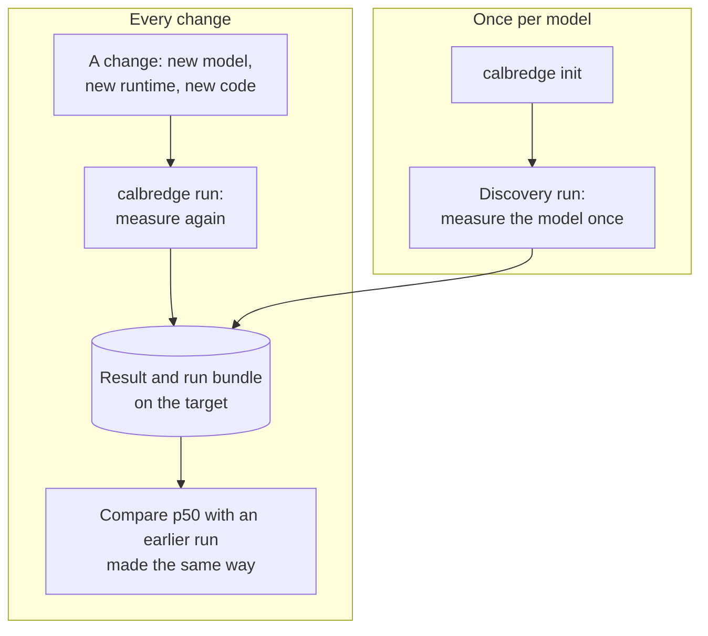

# How Calbredge works

Calbredge measures a model's inference latency on the hardware it will ship on, the same way
every time, and records with each run everything needed to tell whether two runs compare.

Setting it up: `docs/QUICKSTART.md`. Which targets it supports, and what it measures on each:
`docs/SUPPORTED_PLATFORMS.md`. The measurement method in full: `docs/PROTOCOL.md`.

## The concepts

**Target.** The hardware and runtime a model runs on in production, for example a Jetson Orin
Nano Super running TensorRT FP16. Latency is only meaningful on the target itself, so Calbredge
always measures there.

**Performance state.** The power mode the target runs in, with its processor speeds locked.
Choose the mode your product deploys in, and use it for every run you mean to compare.

**Project.** A folder in your git repository with the files that say which model to measure
and how (`.calbredge/project.yaml` and the protocol beside it). They are committed with your
code, so a change to how the model is measured is reviewed like any other change. The model
itself can be committed too, or kept elsewhere (see below).

**Protocol.** The measurement procedure: the input shape, how many warm-up iterations, how
many measured ones. The same protocol for every run is what makes two runs comparable; its
digest is recorded with each run.

**Run.** `calbredge run`: load the model, warm it up, then time every measured iteration
individually. Warm-up is never timed, and the timed loop measures only inference.

**Result.** What a run records: p50, p90 and p99 latency, throughput, power and temperature
where the target reports them, and what ran (hashes of the model and the compiled engine, the
runtime and its version, the protocol, the power mode, whether the speeds were locked). A value
that could not be read is recorded as missing, never as zero.

**Run bundle.** A folder for each run, under `~/.calbredge/runs/`, with the result, the latency
of every measured iteration, the software environment and the run's log. The summary statistics
can be recomputed from the samples.

## The flow

## The power mode, and why the speeds are locked

An edge device offers several power modes; a Jetson, for example, has modes such as 7W, 15W, 25W
and MAXN_SUPER. Choose the one your product deploys in: latency in one mode says little about
another, so compare only runs made in the same mode.

Within a mode, a processor normally speeds up and slows down with load and temperature. Two runs
of the same model can differ by more than a real regression just because the speeds differed.
On a Jetson, NVIDIA's `jetson_clocks` locks the CPU, GPU and memory at the highest speed the
chosen power mode allows, so their speed can't change during a measurement, and a change in
latency comes from the change you made. Calbredge records the power mode and whether the speeds
were locked for every run.

This means results are the chosen mode's steady best case: what the model does with the
hardware running at full speed within that mode. A product whose speeds vary with load may be
slower at times; a steady best case is what makes two runs comparable.

## When two runs compare

A number is only a regression if the comparison was fair. A run on a different power mode, a
different runtime version, a different input shape or with speeds that weren't locked can be
slower or faster for reasons that have nothing to do with your change. Every result therefore
records those facts, and `docs/QUICKSTART.md` lists the fields to check before comparing two
runs. A run that was too noisy to use says so in its status.

## Models kept out of git

Calbredge identifies a model by its SHA-256, the fingerprint of the file's contents, not by
where it is stored or by git. The repository has to hold the project's Calbredge files; the
model can be committed with them, stored with Git LFS, or kept out of git (in an artifact store
or model registry, say) and put in place before a run. A run needs only the file, at the path
you give it, on the target. The result holds the model's SHA-256, so it always says exactly
which file was measured. Git-ignore the model's folder so a downloaded file never shows up as a
change to the repository.
